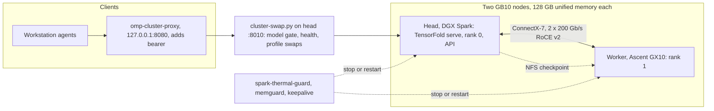

# kodros-gb10-deepseek-tp2

How the [Kodros](https://kodros.ai) local inference cluster serves DeepSeek-V4.1-Flash-1017 across two GB10 machines (an NVIDIA DGX Spark and an ASUS Ascent GX10) with tensor parallelism. The repo holds the settings, one patch to the upstream recipe, the watchdogs that keep the pair serving, and the measurements behind each setting. No model weights are here.

## How it works

Static diagram: [docs/architecture.svg](docs/architecture.svg). Step-by-step build: [BUILD.md](BUILD.md).

The engine is TensorFold's native engine running the EXL3 2.9 bpw quantization at TP=2, with an OpenAI-compatible API, a 1,048,576-token context and 8 concurrent streams. A thermal guard stops both ranks at 89 C, a memory guard kills a rank below 1 GiB free, and a keepalive restarts the pair once both nodes are cool.

## Measured (2026-10-27, full client path)

| Measurement | Result |
| --- | ---: |
| Decode, 1 stream | 96.1 tok/s |
| Decode, 8 streams, aggregate | 327.9 tok/s |
| Cold prefill at 45.3K prompt tokens | 4,322 tok/s |
| Repeat of a 45K-token prompt (prefix reuse) | 0.44 s vs 10.5 s cold |
| Agent traffic over 8.7 h, prompt tokens recomputed | 4.15 % of 76.6M |
| Hottest SoC sensor, 60 s at 8 streams | 70.5 C |

Two changes from the recipe defaults did most of the work: `PARALLEL=8` raised 4-stream throughput 73 %, and `RDMA_NAP_US=2000` cut sustained SoC peak by 6 C at the same speed. Evidence for every row: [docs/evidence/](docs/evidence/).

## Stack

TensorFold native engine (Zig), EXL3 weights, Docker with the NVIDIA runtime, RoCE v2 over ConnectX-7, systemd units, Python and Bash watchdogs.

## Run

You need two GB10 machines prepared as the [upstream recipe](https://github.com/MiaAI-Lab/DeepSeek-v4.1-Flash-1017-2x-DGX-Sparks) describes. Clone it at the pinned commit, apply `recipe/patches/0001-start-port-check-bound-host.patch`, copy `recipe/env` and `recipe/local.sh.example` with your own addresses, then `DRY_RUN=1 ./start.sh`. Step by step: [docs/DEPLOYMENT.md](docs/DEPLOYMENT.md). Watchdogs and units: [docs/OPERATIONS.md](docs/OPERATIONS.md).

Published files use `192.0.2.1` (head), `192.0.2.2` (worker) and `user` in place of real addresses and accounts.

## Status and limits

- Output quality of the abliterated overlay against the stock checkpoint has not been measured.
- The thermal guard stopped the pair 9 times between 2026-10-22 and 2026-10-27. Multi-day uptime under these settings is not proven.
- The cluster has since moved between models; this repo records one dated deployment.

## License and credits

Apache License 2.0 for the scripts, units and docs here ([LICENSE](LICENSE), [NOTICE](NOTICE)). The recipe is by Mia's AI Lab, the engine by TensorFold contributors, the model by DeepSeek. Full credits: [docs/DEPLOYMENT.md](docs/DEPLOYMENT.md#license-and-credits).
