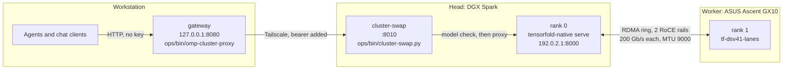
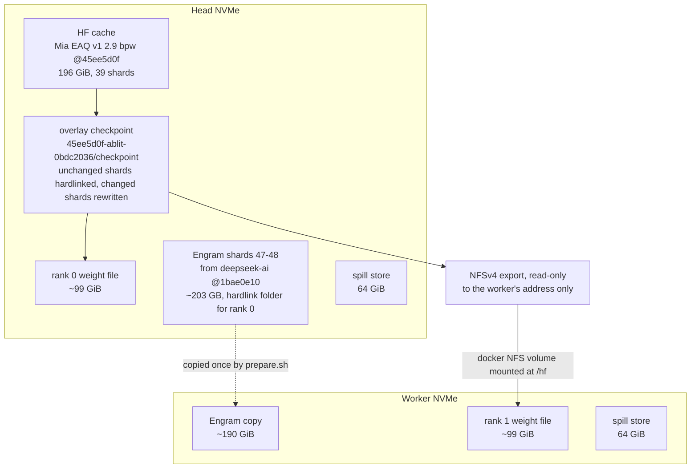
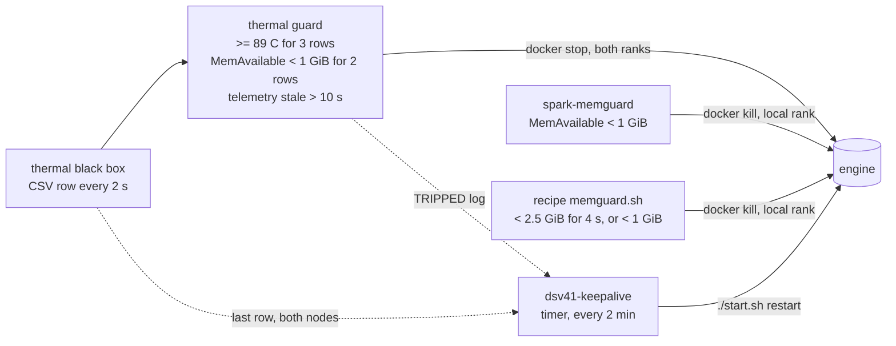

# Architecture

Two GB10 machines serve one model. The head (a DGX Spark) runs rank 0, which owns the API, the vision tower and the
scheduler. The worker (an ASUS Ascent GX10) runs rank 1, which holds the other half of every layer. The ranks meet over
an RDMA ring on the ConnectX-7 link twice per layer. Nothing else in the system can serve a token: if either rank stops,
both stop.

Addresses below are placeholders: `192.0.2.1` is the head's link address, `192.0.2.2` the worker's.

## Request path

1. Clients on the workstation call `http://127.0.0.1:8080/v1` with any or no key. The gateway adds the cluster bearer
   from a local env file and forwards to the head's `:8010` over Tailscale. When a client hangs up, the gateway closes
   the upstream socket so the engine cancels the stream.
2. `cluster-swap` on the head answers `/health` itself, refuses traffic while a `THERMAL_QUALIFICATION` hold file
   exists, checks before each request that the engine's `/v1/models` matches the current profile, rewrites a known
   `model` field to the served id, and streams the reply back. Its `/swap` routes need a separate token and are
   unused for this profile.
3. Rank 0 serves the OpenAI-compatible API on the link address only. It has no API key: its boot log says
   `non-loopback server has no API key; requests are open`. Keep `:8000` off networks you do not control.
4. Rank 0 and rank 1 bootstrap over TCP (`TF_TP_MASTER`, port 29620) and then exchange activations over the RDMA ring
   on both rails (`TF_RDMA_DEVICES=rocep1s0f0,roceP2p1s0f0`, GID index 3). When the ring fails, rank 0 exits with
   status 75 so both ranks are restarted together.

Engine settings that shape a request: 1,048,576-token window shared as one pool by 8 streams, 32,768 default reply
tokens, temperature 1.0 / top-p 0.95 / top-k 20 unless the request sets its own, thinking on unless the request turns
it off, DSpark drafting from the checkpoint's own draft blocks, prompts processed in 2,048-row chunks, and decode rounds
interleaved between prompt chunks every 250 ms so a long prompt does not freeze other streams.

## Weights and storage

- The checkpoint lives once, on the head. A container on the head exports the Hugging Face cache over NFSv4
  (`fsid=0`, read-only, one client). The worker mounts it as a Docker NFS volume, reads the small files and writes its
  own weight file from it during preparation.
- The overlay replaces 104 attention tensors in layers 10-35 (upstream README). Preparation keeps the stock snapshot
  intact by hardlinking unchanged shards into a separate overlay folder and writing only the changed ones there.
- Each rank loads a single pre-split weight file. At start the boot log reports `95.1 GiB of expert entries read whole`
  in 9.7 s on the head and 20.8 s on the worker.
- Engram's two n-gram tables are read with random 4 KiB reads during decode, so each node keeps them on local NVMe. The
  head's copy is a folder of hardlinks to the Hugging Face blobs, because the spill fingerprint ignores symlinks
  (see [PERFORMANCE.md](PERFORMANCE.md#spill-v2)).
- Spill v2 keeps evicted prompt states on each node's own NVMe (64 GiB cap, at least 50 GiB left free on that file
  system, only prompts of 8,192 tokens or more).

## Control loops

Stopping and starting are separate on purpose. Three watchdogs can stop the engine and none of them restarts it. One
timer restarts it, and only when:

- neither `OWNER_AWAY_HOLD` nor `THERMAL_QUALIFICATION` exists,
- no `start.sh` or `prepare.sh` is already running,
- the engine is down on either node, or up but not answering `/v1/models` after 15 minutes,
- the worker answers ssh,
- the head's two ACPI zones and the worker's first zone all read below 70 C,
- the last thermal or memory trip is at least 15 minutes old,
- fewer than 4 restarts happened in the last 6 hours.

The guard and the black box run on both nodes. The keepalive runs on the head only. Details and thresholds are in
[OPERATIONS.md](OPERATIONS.md).

## Memory budget

GB10 shares 128 GB between CPU and GPU. Nothing in the engine keeps `MemAvailable` above a floor while it runs, so the
budget is set at load time and guarded at run time.

| Item | Head (rank 0) | Worker (rank 1) | Source |
| --- | --- | --- | --- |
| Model on the GPU at load (weights, graphs) | 104.96 GiB | not logged | rank 0 boot line |
| Engine reserve left for the system | 12.2 GiB | | rank 0 boot line |
| Rank 1 arena | | 4.54 GB | rank 1 boot line |
| KV cache, compressed FP4, full 1M window | ~1.8 GiB in total | | upstream README |
| Prompt-state cache | 512 MiB | | rank 0 log |
| `MemAvailable` minutes after load, spill on (2026-10-27 19:06Z) | 5.99 GiB | 7.90 GiB | [M9](evidence/2026-10-27-measurements.md) |
| Start refused below | 112 GiB available | 112 GiB available | `MIN_AVAIL_GIB` |
| Recipe memguard kills below | 2.5 GiB for 4 s, or 1 GiB | same | `scripts/memguard.sh` |
| Our guards stop below | 1 GiB | 1 GiB | `ops/bin/spark-thermal-guard`, `ops/bin/spark-memguard` |

The head carries more than the worker: the API server, the vision tower, the prompt cache, the NFS export container
and a few small services. A long cold prompt borrows a few GiB of workspace for a moment, which is why the floors sit
well under the idle reading. Upstream measured four parallel 500K-token cold prompts bottoming at about 3.3 GiB on a
headless head.
